<p align="center">
  
</p>

# ReParte

> La comida que sobra no se tira: se reparte.

Aplicación móvil que conecta a restaurantes y supermercados con
asociaciones que reparten alimentos, para reducir el desperdicio de
comida en buen estado.

## Para revisar este repositorio

| | |
|---|---|
| Repositorio | <https://github.com/MiguelAlvarezIbarra/ReParte> (público) |
| Rama a revisar | **`main`**: versión estable. El trabajo diario va en `develop` y en ramas `feature/Txx` |
| Seguridad | [docs/SEGURIDAD.md](docs/SEGURIDAD.md): secretos, controles y dependencias |
| Reportar un problema de seguridad | [SECURITY.md](SECURITY.md): en privado, nunca en un issue público |
| Servicios en la nube | [Servicios en la nube y API](#servicios-en-la-nube-y-api), en este README |
| Pruebas de seguridad | [docs/pruebas/seguridad.md](docs/pruebas/seguridad.md), con resultados |
| Prueba del flujo completo | [docs/pruebas/flujo-completo.md](docs/pruebas/flujo-completo.md), con capturas |

En el repositorio **no hay secretos**. La configuración de Firebase que está
versionada son identificadores públicos (ver [Configuración y secretos](#configuración-y-secretos)).

## Estado del proyecto

| Sprint | Fechas | Estado |
|---|---|---|
| Sprint 1 — Base del proyecto | 5 al 16 de octubre | Terminado |
| Sprint 2 — Núcleo de donaciones | 19 al 30 de octubre | Terminado |
| Sprint 3 — Reserva y avisos | 2 al 13 de noviembre | Terminado |
| Cierre y demostración | 16 al 20 de noviembre | En curso |

Lo que ya funciona:

- **Cuentas:** registro con correo y contraseña eligiendo el rol (**donante** o
  **asociación**), inicio de sesión, sesión que se mantiene, perfil y
  **recuperar la contraseña** por correo.
- **Donante:** publica una donación con descripción, kilos, fecha de caducidad y
  punto de entrega elegido en el mapa, y puede **tomar o elegir una foto** del
  alimento (se reduce antes de guardarla); ve *Mis donaciones* con su estado
  (activas e historial).
- **Asociación:** ve las donaciones disponibles en tiempo real, las busca, las ve
  en un **mapa**, abre el detalle, la **reserva** y ve *Mis reservas*.
- **Una sola reserva:** si dos asociaciones reservan la misma donación al mismo
  tiempo, solo una lo logra y la otra recibe el aviso de que ya no está disponible.
- **Aviso al donante:** le llega una notificación al teléfono cuando una
  asociación reserva su donación, con quién la reservó, qué y cuántos kilos.
- **Entrega:** el donante o la asociación marcan la donación como entregada y
  queda cerrada con su fecha y los kilos rescatados.
- **Cómo llegar:** muestra la ruta al punto de entrega dentro del mapa de la app
  (distancia y tiempo) o la abre en la app de mapas del teléfono.
- **Sin conexión:** avisa cuando el teléfono se queda sin red, muestra lo último
  guardado y permite reintentar cuando algo no carga.
- **Logo de ReParte** en el ícono de la app, la pantalla de carga, el inicio de
  sesión y las notificaciones.
- **Seguridad:** las reglas de Cloud Firestore exigen sesión, no dejan cambiar el
  rol, permiten publicar solo a donantes y reservar solo a asociaciones, validan
  los datos y protegen el ciclo de la donación (disponible → reservada → entregada).

Con esto queda completo el ciclo de una donación (historias H1 a H6), probado de
principio a fin en un teléfono real: ver [la prueba del flujo completo](docs/pruebas/flujo-completo.md).

## Capturas

Tomadas en un teléfono real durante la
[prueba del flujo completo](docs/pruebas/flujo-completo.md), con las cuentas de prueba.

### Donante

| Iniciar sesión | Inicio del donante | Publicar donación | Mis donaciones |
| :-: | :-: | :-: | :-: |
| 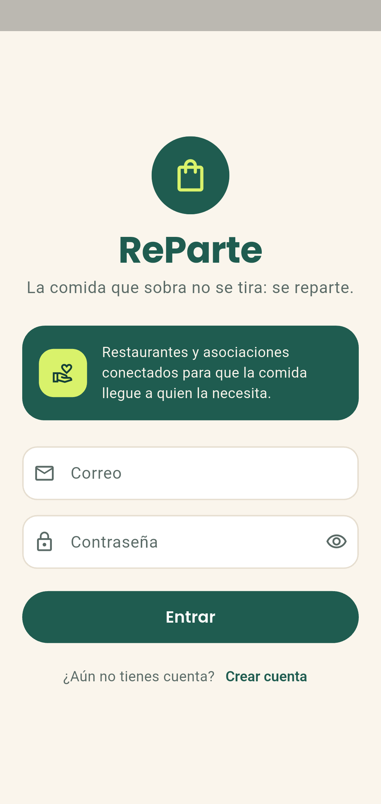 | 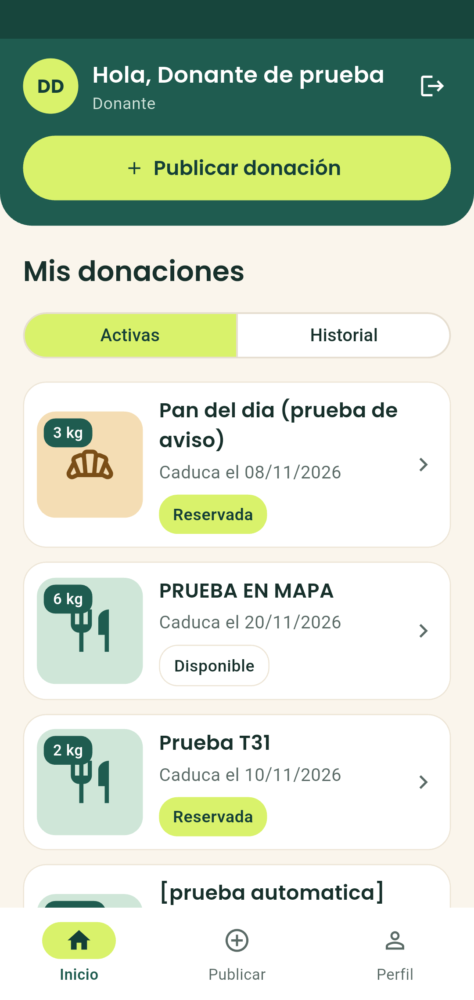 | 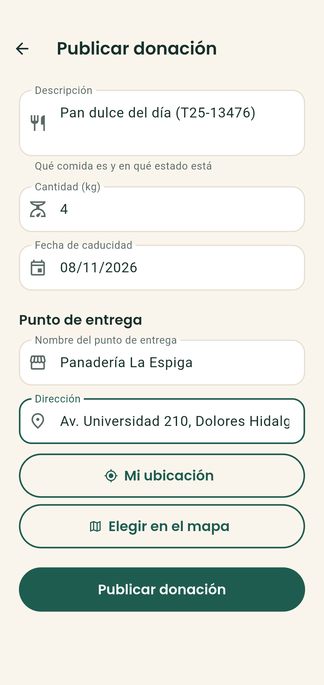 | 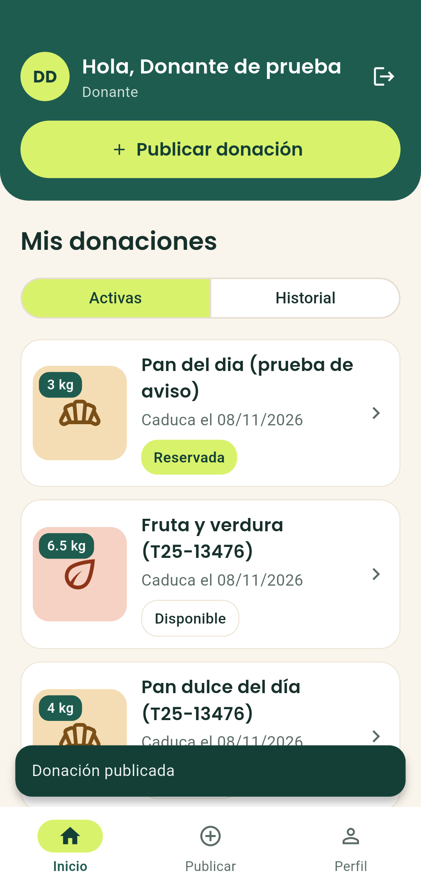 |

### Asociación

| Donaciones disponibles | Detalle | Reserva confirmada | Mis reservas |
| :-: | :-: | :-: | :-: |
| 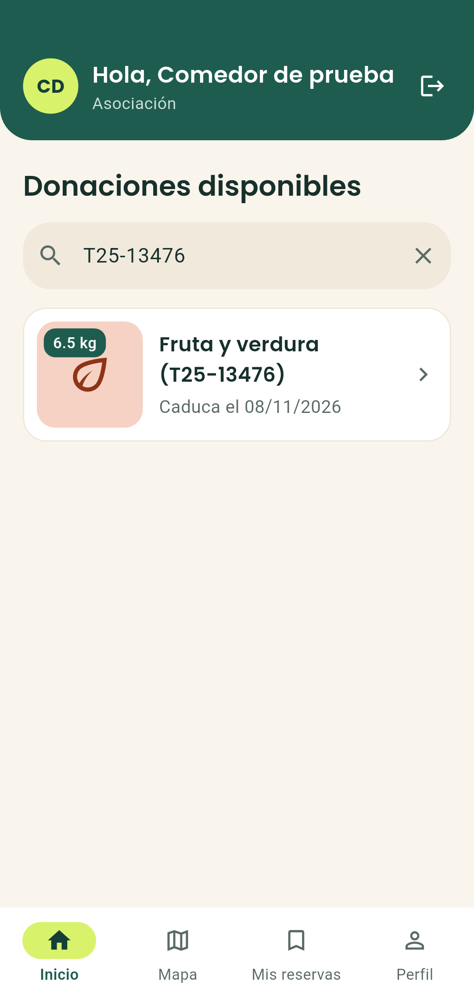 | 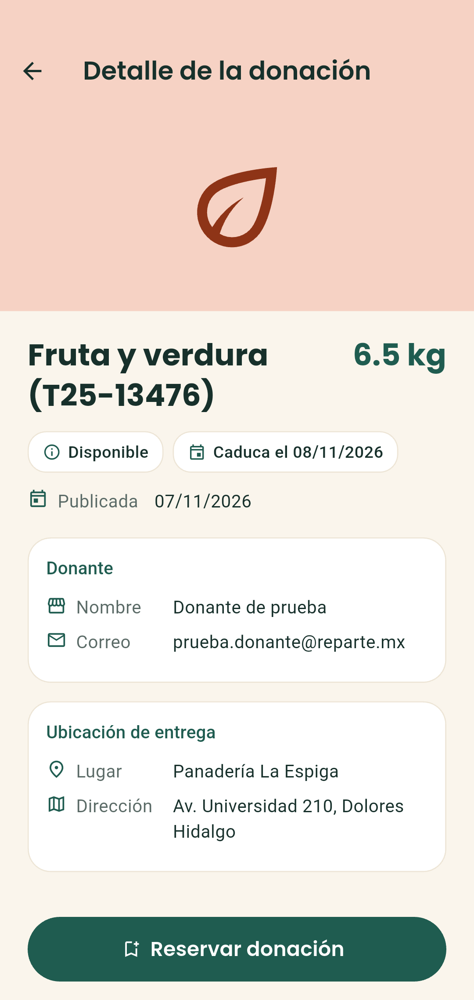 | 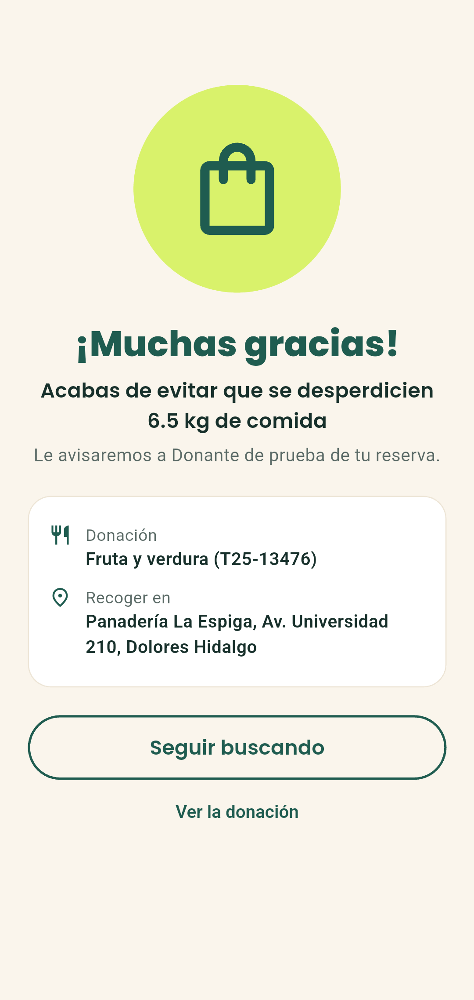 | 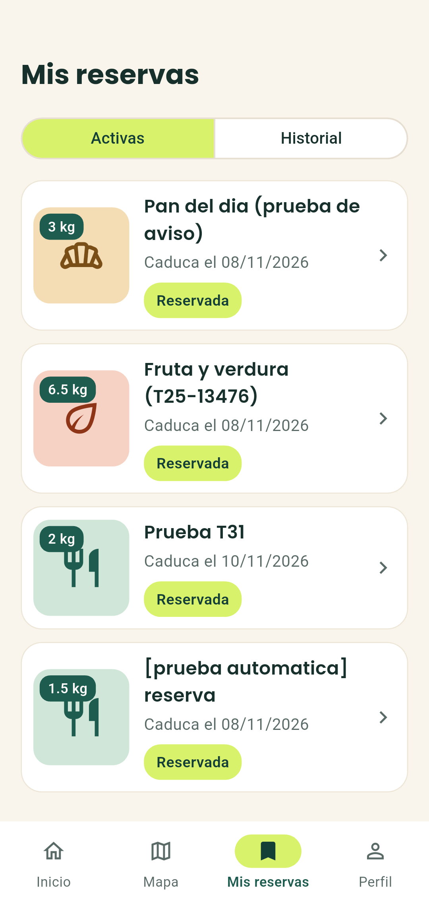 |

### Aviso y entrega

| Donación reservada | Donante entrega | Asociación entrega | Historial |
| :-: | :-: | :-: | :-: |
| 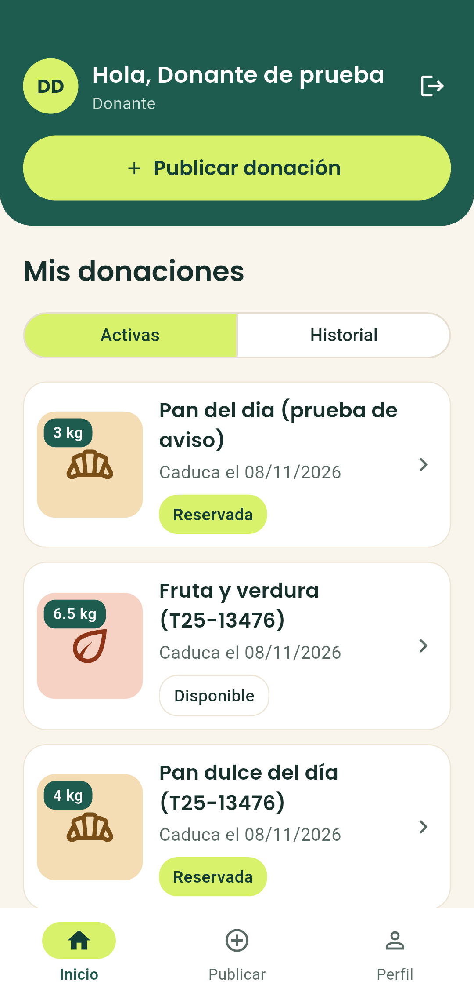 | 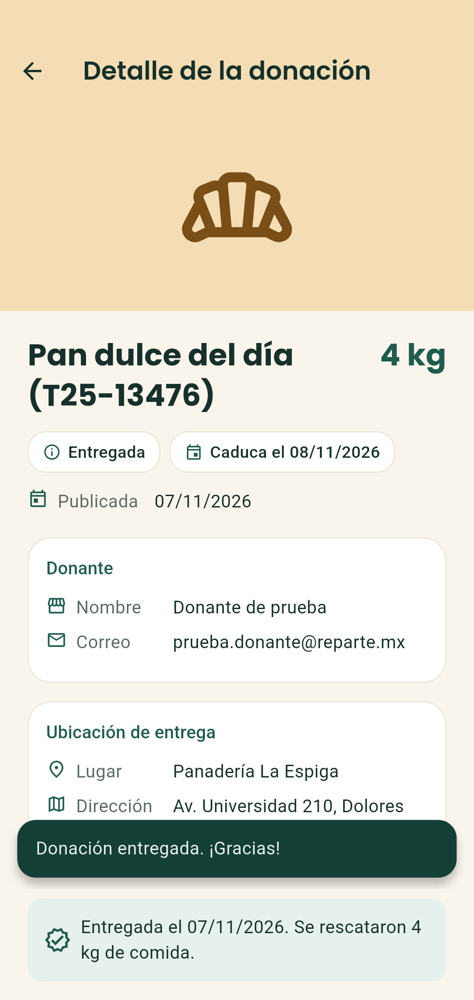 | 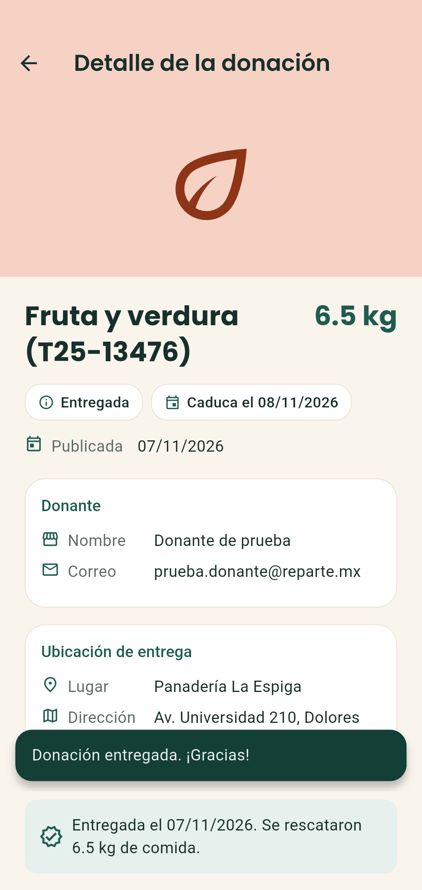 | 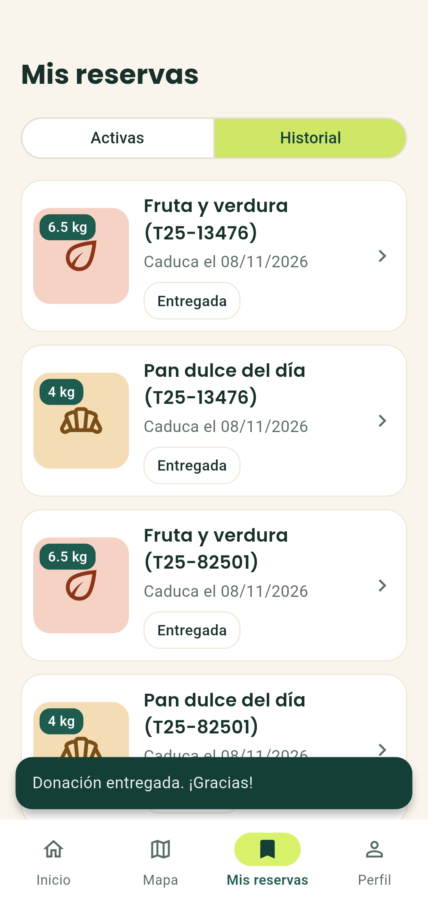 |

<p align="center">
  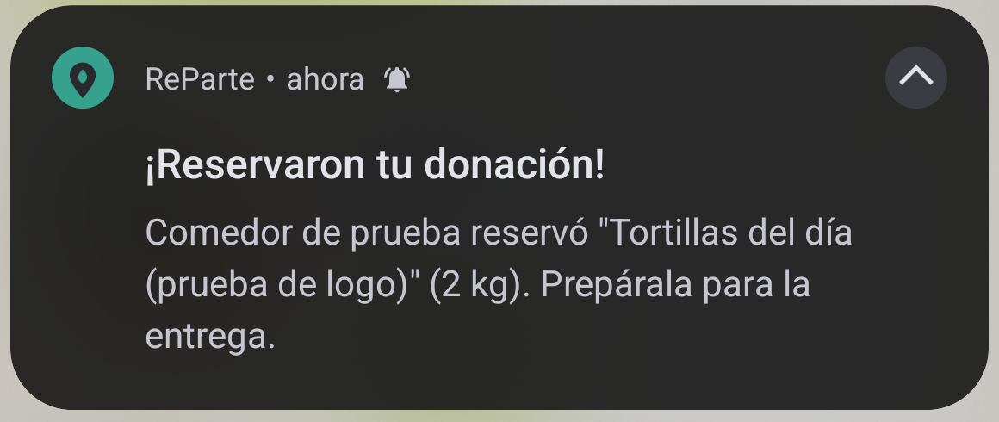
  <br><em>Aviso al donante cuando reservan su donación.</em>
</p>

Pendiente: guardar la foto de la donación en la nube (T35), cerrar el APK de
release (T27) y el guion de la demostración (T28).

## Equipo

| Integrante | Rol |
|---|---|
| Miguel Ángel Álvarez Ibarra | Product Owner |
| Pedro Uriel Pérez Monzón | Dev Team / Líder Técnico |
| Claudio Ángel Huerta Ducoing | Scrum Master |

## Tecnología

| Uso | Herramienta |
|---|---|
| App móvil | Flutter (Dart) con arquitectura MVVM |
| Estado e inyección de dependencias | `provider` |
| Autenticación | Firebase Authentication (`firebase_auth`) |
| Base de datos | Cloud Firestore (`cloud_firestore`) |
| Mapas | `flutter_map` con OpenStreetMap y `latlong2` (sin API key) |
| Ubicación | `geolocator` y `geocoding` |
| Ruta dentro de la app | Servidor público de OSRM con `http` (sin API key) |
| Abrir la ruta en la app de mapas | `url_launcher` |
| Notificaciones | `flutter_local_notifications` |
| Detectar falta de conexión | `connectivity_plus` |
| Tipografía | Poppins (incluida en `assets/fonts`, licencia OFL) |
| Pruebas | `flutter_test`, `mockito`, `integration_test` |

## Servicios en la nube y API

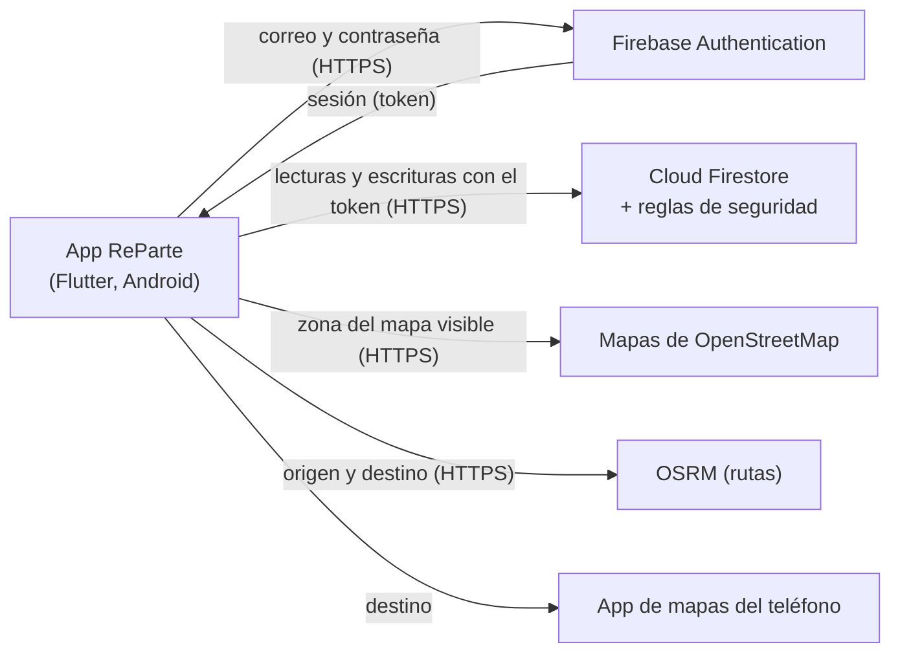

| Servicio | Para qué | Datos que intercambia | Configuración | Límites de acceso |
|---|---|---|---|---|
| **Firebase Authentication** | Cuentas, inicio de sesión y recuperar contraseña | Envía correo y contraseña; recibe el id del usuario y un token de sesión. Firebase manda el correo de recuperación | `google-services.json` y `firebase_options.dart` (públicos). Plantilla del correo: [docs/correos](docs/correos/README.md) | Solo correo y contraseña. Contraseñas de al menos 6 caracteres |
| **Cloud Firestore** | Base de datos en tiempo real | `usuarios` (nombre, correo, rol, teléfono), `donaciones` (descripción, kilos, caducidad, estado, quién publica y quién reserva) y `puntos_entrega` (nombre, dirección, coordenadas, horario) | Las mismas claves públicas; reglas en [`firestore.rules`](firestore.rules) | Sin sesión no se lee ni escribe nada. Cada rol solo hace lo suyo (ver [docs/SEGURIDAD.md](docs/SEGURIDAD.md)) |
| **OpenStreetMap** (`flutter_map`) | Dibujar los mapas | Las coordenadas de la zona visible del mapa; la app se identifica como `com.reparte.reparte` | Sin clave | Política de uso de los mapas de OpenStreetMap |
| **OSRM** (servidor público) | Calcular la ruta dentro de la app | Coordenadas de origen (ubicación del usuario) y destino | Sin clave ([`rutas_service.dart`](lib/services/rutas_service.dart)) | Servidor de demostración: pocas consultas por segundo; si falla, la app muestra un mensaje y ofrece abrir la app de mapas |
| **App de mapas del teléfono** (`url_launcher`) | "Cómo llegar" paso a paso | Coordenadas del punto de entrega | Sin clave | Lo abre el usuario con un botón |
| **Geocodificación del teléfono** (`geocoding`) | Convertir coordenadas en dirección | Coordenadas elegidas en el mapa | Sin clave (servicio del sistema Android) | Solo al elegir el punto de entrega |
| **Notificaciones locales** (`flutter_local_notifications`) | Avisar al donante cuando reservan su donación | Ninguno: se generan en el teléfono a partir de los cambios de Firestore | Permiso de notificaciones de Android | Funciona con la app abierta o en segundo plano |

Para avisar con la app totalmente cerrada haría falta Cloud Functions con
Firebase Cloud Messaging, que requiere el plan Blaze de Firebase.

## Cómo ejecutarlo

Requisitos: **Flutter 3.47 estable o superior** y un teléfono o emulador **Android 7.0 o superior**.

```bash
git clone https://github.com/MiguelAlvarezIbarra/ReParte.git
cd ReParte
flutter pub get
flutter run
```

No hace falta configurar nada más para usar la app: ya trae la conexión a Firebase.
Para entrar, toca **Crear cuenta** y elige el rol (donante o asociación). Si quieres
ver el ciclo completo, crea una cuenta de cada rol.

La app ya está conectada al proyecto de Firebase `reparte-a3c07`
(`android/app/google-services.json` y `lib/firebase_options.dart`).
La primera compilación tarda bastante porque descarga Gradle 8.14 y el NDK de Android.

Las reglas de seguridad están en `firestore.rules`. Si se cambian, se publican con
`firebase deploy --only firestore:rules --project reparte-a3c07`. El diseño del
correo de recuperación de contraseña se configura en Firebase Console: los pasos
están en [docs/correos](docs/correos/README.md).

### Instalar en un teléfono (APK de release)

```bash
flutter build apk --release
flutter install --release -d <id-del-telefono>   # el id sale de: flutter devices
```

El APK queda en `build/app/outputs/flutter-apk/app-release.apk` (unos 55 MB) y se
puede copiar al teléfono e instalar sin herramientas de desarrollo. Está firmado
con la llave de depuración, suficiente para la demostración. El teléfono debe
permitir instalar apps de orígenes desconocidos y tener internet.

### Configuración y secretos

| Archivo | ¿Va en el repositorio? | Qué contiene |
|---|---|---|
| `android/app/google-services.json`, `lib/firebase_options.dart` | Sí | Identificadores **públicos** del proyecto de Firebase (`apiKey`, `appId`, `projectId`). Firebase los diseña para ir dentro de la app; no dan acceso a los datos. Lo que protege la información son Firebase Authentication y las reglas de [`firestore.rules`](firestore.rules) |
| `pruebas.env.json` | **No** (en `.gitignore`) | Cuentas de prueba para las pruebas contra Firebase real |
| [`pruebas.env.example.json`](pruebas.env.example.json) | Sí | Ejemplo con valores **ficticios** (`TU_CONTRASENA_AQUI`) |
| `key.properties`, `*.jks` | **No** (en `.gitignore`) | Llave para firmar el APK de release |

Para correr las pruebas contra Firebase real:

1. Copia `pruebas.env.example.json` como `pruebas.env.json`.
2. Llena los valores con las cuentas de prueba, que el equipo comparte por un
   canal privado (nunca en el repositorio ni en issues).
3. Ejecuta las pruebas con `--dart-define-from-file=pruebas.env.json`.

Para usar otro proyecto de Firebase: crea el proyecto, activa Authentication
(correo y contraseña) y Firestore, ejecuta `flutterfire configure` (regenera los
dos archivos públicos) y publica las reglas.

## Pruebas

```bash
flutter analyze                 # análisis estático
flutter test                    # pruebas unitarias y de widgets
flutter test integration_test --dart-define-from-file=pruebas.env.json   # Firebase real, con teléfono

# flujo completo H1 a H6 en el teléfono, guardando capturas en docs/pruebas/capturas
flutter drive --driver=test_driver/integration_test.dart \
  --target=integration_test/flujo_completo_test.dart \
  --dart-define-from-file=pruebas.env.json
```

Estado actual en `main`: `flutter analyze` sin problemas, **201 pruebas
aprobadas** y **10 pruebas de integración** aprobadas en un Redmi Note 13 Pro
con Android 16 (las 9 anteriores también en un Samsung A51 con Android 13). GitHub Actions corre el
análisis y las pruebas unitarias en cada PR. Entre ellas están el
**flujo completo de las seis historias**, con 13 capturas como evidencia en
[docs/pruebas/flujo-completo.md](docs/pruebas/flujo-completo.md), y la **prueba
de seguridad**, que intenta escribir en Firestore lo que no se debe (cambiarse el
rol, publicar con 0 kilos, reservar siendo donante, leer sin sesión…) y
comprueba que se rechace. Resultados caso por caso en
[docs/pruebas/seguridad.md](docs/pruebas/seguridad.md).

Ojo: `flutter test integration_test` reemplaza el APK de depuración por uno de
prueba. Para probar la app a mano después, usa `flutter run`.

| Carpeta | Qué prueba |
|---|---|
| `test/models/` | Conversión desde y hacia JSON y validaciones de los modelos |
| `test/repositories/` | Repositorios con Firestore simulado (mockito): guardar, consultar, reservar, doble reserva, entregar y fallas |
| `test/viewmodels/` | Inicio de sesión, recuperar contraseña, lista y búsqueda, detalle, reserva y entrega, publicar, mapa, ruta, *Mis donaciones* y avisos de reserva |
| `test/views/` | Pantallas: acceso, recuperar contraseña, logo, navegación por rol, barra inferior, lista, detalle, reservar, entregar, publicar, errores y sin conexión |
| `test/services/` | Ubicación y cálculo de la ruta |
| `test/core/` | Validadores y formatos |
| `integration_test/` | Contra Firebase real: inicio de sesión, publicar, reservar, doble reserva, entregar, el flujo completo H1 a H6 y las reglas de seguridad |

## Arquitectura

```text
Vista ──► ViewModel ──► Repositorio ──► Servicio ──► Firebase
```

Las dependencias van en una sola dirección: una vista conoce a su
ViewModel, el ViewModel a un repositorio y el repositorio a los
servicios. Nunca al revés. Solo los servicios usan el SDK de Firebase.

Patrones aplicados: **Repository**, **Inyección de dependencias** (Provider),
**Observer** (`ChangeNotifier` y los streams de Firestore en tiempo real) y
**Factory** (`PantallaInicioFactory` elige la pantalla según el rol).

## Estructura del proyecto

```text
lib/
├── core/           Tema (colores y tipografía), constantes y utilidades
├── models/         Usuario, Donacion y PuntoEntrega
├── services/       Auth, Firestore, ubicación, rutas, notificaciones, conexión y selector de foto: los únicos que hablan con el exterior
├── repositories/   UsuarioRepository y DonacionRepository
├── viewmodels/     Lógica y estado de cada pantalla
├── views/
│   ├── auth/       Inicio de sesión y registro
│   ├── inicio/     Puerta de acceso e inicio de cada rol con su barra inferior
│   ├── donaciones/ Lista, detalle, publicar, reserva confirmada y mis donaciones
│   ├── mapa/       Elegir ubicación, mapa de donaciones y ruta al punto de entrega
│   └── perfil/     Datos de la cuenta
├── widgets/        Componentes reutilizables (tarjetas, etiquetas, encabezados)
└── routes/         Nombres de las rutas de navegación
assets/fonts/       Tipografía Poppins
docs/SEGURIDAD.md   Controles de seguridad, secretos y dependencias
docs/pruebas/       Resultados de las pruebas de seguridad y del flujo completo, con capturas
docs/correos/       Plantilla del correo para recuperar la contraseña
integration_test/   Pruebas contra Firebase real en un teléfono (incluye las de seguridad)
test_driver/        Guarda las capturas de las pruebas en el teléfono
.github/            GitHub Actions (análisis y pruebas en cada PR) y Dependabot
firestore.rules     Reglas de seguridad de Firestore (autorización en el servidor)
pruebas.env.example.json  Ejemplo con valores ficticios de las cuentas de prueba
```

## Flujo de trabajo

- Una tarea del tablero equivale a una rama y a un Pull Request.
- Ramas con el formato `tipo/descripcion`, por ejemplo `feature/T08-autenticacion`
  o `docs/readme-sprint-1`. Tipos: `feature`, `fix`, `docs` y `revert`.
- Commits con el mismo tipo al inicio: `feature: agrega la seleccion de rol en el registro`.
- Las ramas salen de `develop` y regresan ahí mediante PR, aprobado por un
  integrante distinto al autor.
- `main` solo recibe versiones estables, al terminar una funcionalidad principal.

## Enlaces

- Tablero: [GitHub Projects — @ReparTe Kanban](https://github.com/users/MiguelAlvarezIbarra/projects/1)
- Repositorio: [MiguelAlvarezIbarra/ReParte](https://github.com/MiguelAlvarezIbarra/ReParte)
