# Prueba del flujo completo en un dispositivo real (T25)

**Resultado: las seis historias del PMV (H1 a H6) se ejecutaron y pasaron.**

| Dato | Valor |
|---|---|
| Fecha | 7 de noviembre de 2026 |
| Teléfono | Samsung Galaxy A51 (SM-A515F), Android 13 |
| Base de datos | Firebase real del proyecto (`reparte-a3c07`) |
| Cuentas | `prueba.donante@reparte.mx` (donante) y `prueba.asociacion@reparte.mx` (asociación "Comedor de prueba") |
| Prueba | [`integration_test/flujo_completo_test.dart`](../../integration_test/flujo_completo_test.dart) |
| Duración | 1 min 11 s |
| Resultado | `All tests passed!`, más 190 pruebas unitarias aprobadas |

## Cómo se hizo

La prueba abre la app en el teléfono y la usa como lo haría una persona: escribe en los campos, toca los botones y espera lo que muestra la pantalla. No llama al código por dentro. Las cuentas son reales y todo se guarda en Firestore. En cada paso se toma una captura.

Para la notificación (H5), otra persona tiene que reservar mientras el donante tiene la app abierta, y solo había un teléfono. Esa segunda persona la hace un **"segundo teléfono"**: otra conexión a Firebase, dentro de la misma prueba, con la sesión de la asociación. Para Firebase es otro dispositivo.

Para repetirla, con el teléfono conectado:

```bash
flutter drive --driver=test_driver/integration_test.dart \
  --target=integration_test/flujo_completo_test.dart
```

Las capturas se guardan en [`docs/pruebas/capturas`](capturas). Cada ejecución publica dos donaciones con una marca nueva (por ejemplo `T25-13476`) y al final las deja entregadas, así que no quedan donaciones de prueba disponibles para las asociaciones.

## Resultados por historia

| Historia | Qué se comprobó | Resultado |
|---|---|---|
| **H1** Registro e inicio de sesión | El donante entra con su correo y ve su inicio ("Hola, Donante de prueba", "Mis donaciones"). Cierra sesión y la asociación entra a su propio inicio, con "Donaciones disponibles", Mapa y Mis reservas. | ✅ Pasó |
| **H2** Publicar donación | Se llenan descripción, kilos, caducidad, punto de entrega y dirección. Al publicar sale "Donación publicada" y la donación aparece en Mis donaciones como **Disponible**. | ✅ Pasó |
| **H3** Ver donaciones y detalle | La asociación busca la marca de la prueba, ve la donación en la lista y abre su detalle. La que ya se entregó **no** aparece. | ✅ Pasó |
| **H4** Reservar | La asociación toca "Reservar donación" y ve la confirmación ("¡Muchas gracias! … 6.5 kg de comida"). Un segundo intento de reservar la misma donación es **rechazado** (`DonacionNoDisponible`). La donación aparece en Mis reservas. | ✅ Pasó |
| **H5** Aviso al donante | El segundo teléfono reserva mientras el donante tiene la app abierta. Llega la notificación **"¡Reservaron tu donación!"** con el texto "Comedor de prueba reservó 'Pan dulce del día (T25-13476)' (4 kg). Prepárala para la entrega." En la lista, la donación cambia sola a **Reservada**. | ✅ Pasó |
| **H6** Marcar como entregada | El donante entrega una donación y la asociación la otra. Las dos confirman con "Sí, se entregó" y quedan cerradas: "Entregada el 07/11/2026. Se rescataron 4 kg de comida." La de la asociación pasa a **Historial**. | ✅ Pasó |

Registro de la ejecución (consola de `flutter drive`):

```text
EVIDENCIA H1: el donante entra y ve su pantalla de inicio
EVIDENCIA H2: se publicaron "Pan dulce del día (T25-13476)" y "Fruta y verdura (T25-13476)"
EVIDENCIA H5: el segundo telefono reservó "Pan dulce del día (T25-13476)"
EVIDENCIA H5: notificación "¡Reservaron tu donación!" — Comedor de prueba reservó "Pan dulce del día (T25-13476)" (4 kg). Prepárala para la entrega.
EVIDENCIA H6: "Pan dulce del día (T25-13476)" quedó entregada
EVIDENCIA H3: la asociación ve "Fruta y verdura (T25-13476)" en la lista
EVIDENCIA H4: la asociación reservó "Fruta y verdura (T25-13476)" desde la app
EVIDENCIA H4: el segundo intento de reservar "Fruta y verdura (T25-13476)" fue rechazado (DonacionNoDisponible)
EVIDENCIA H6: "Fruta y verdura (T25-13476)" quedó en el historial como entregada
01:11 +2: All tests passed!
```

## Capturas

### H1. Inicio de sesión según el rol

| Inicio de sesión | Inicio del donante |
|---|---|
| 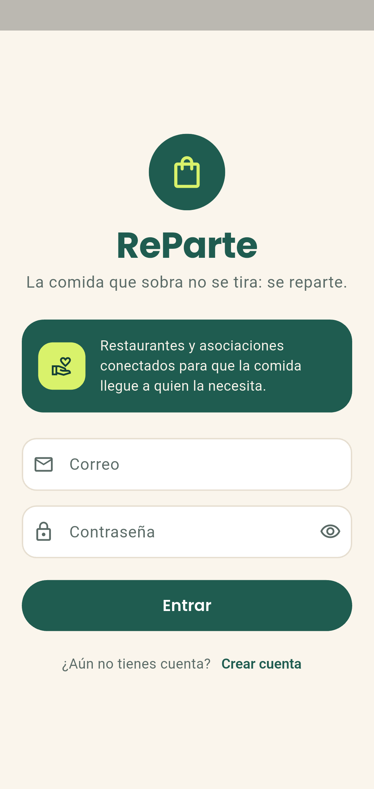 | 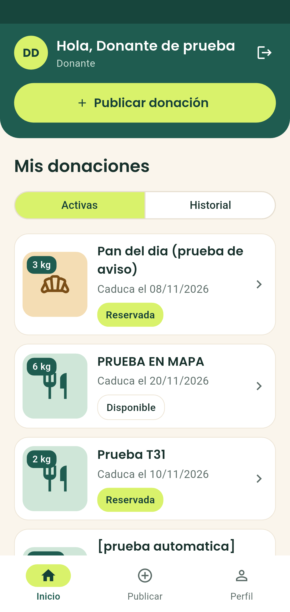 |

### H2. Publicar donación

| Formulario lleno | Publicadas, en Mis donaciones |
|---|---|
| 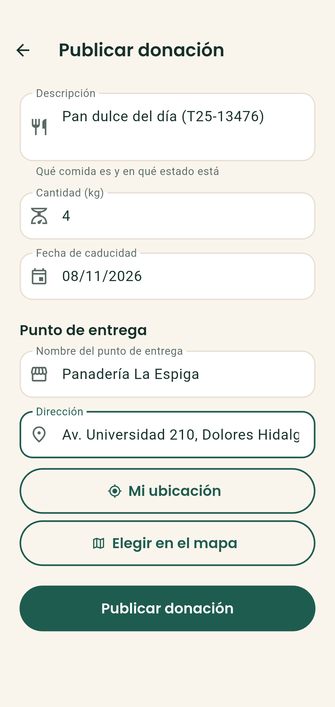 | 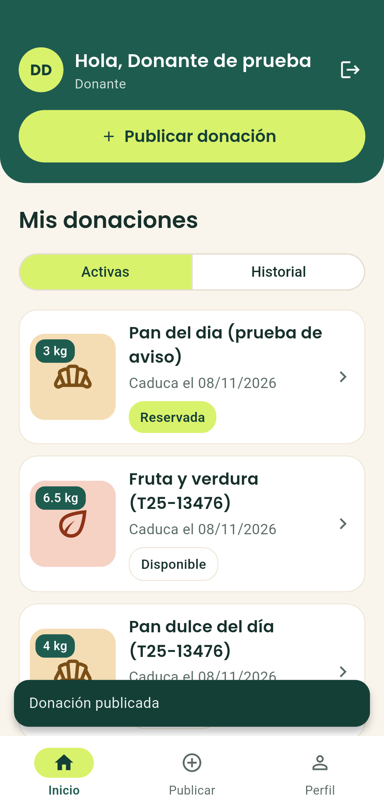 |

### H5. Aviso al donante cuando reservan

| La lista cambia a "Reservada" | Notificación en el teléfono |
|---|---|
| 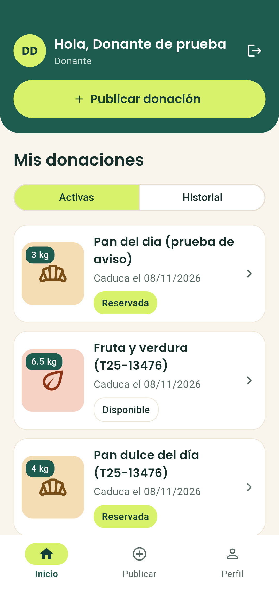 | 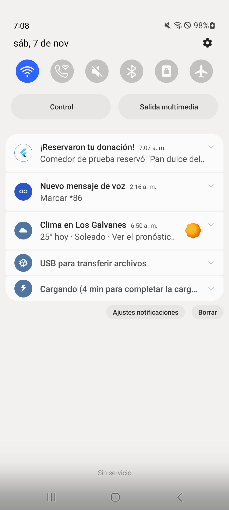 |

### H6. El donante marca como entregada

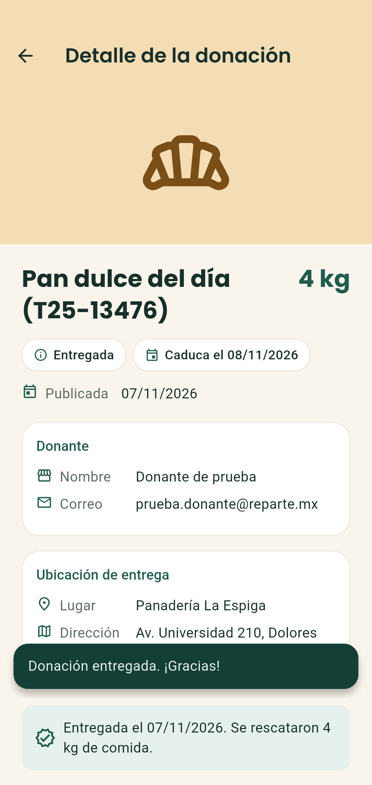

### H3. La asociación ve la lista y el detalle

| Lista de disponibles | Detalle |
|---|---|
| 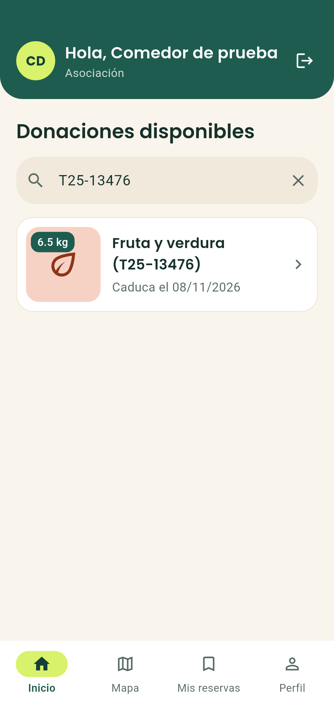 | 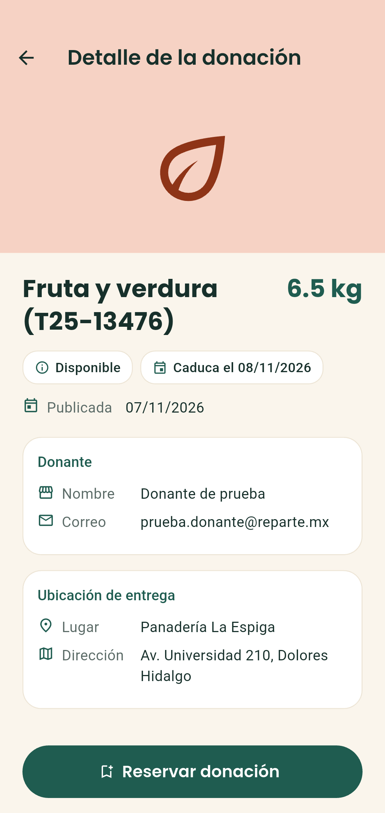 |

### H4. Reservar

| Reserva confirmada | Mis reservas |
|---|---|
| 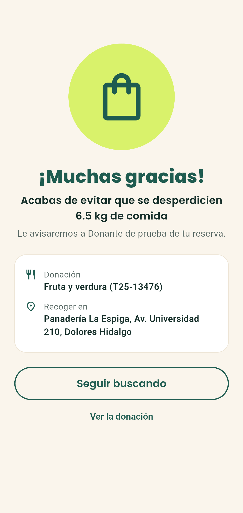 | 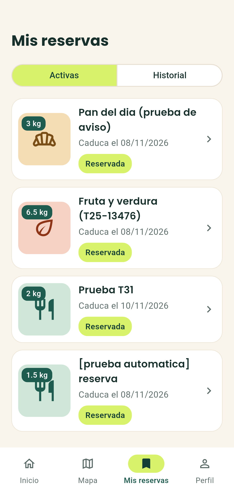 |

### H6. La asociación confirma la entrega

| Entregada | Historial |
|---|---|
| 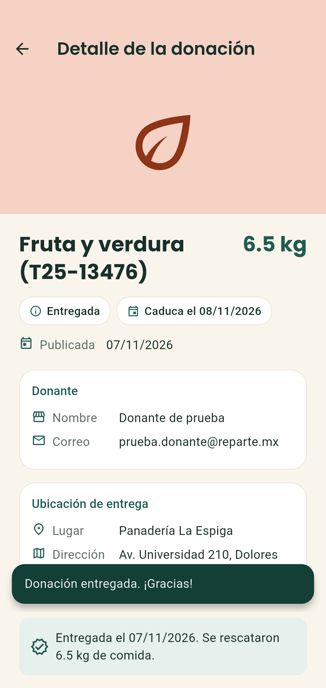 | 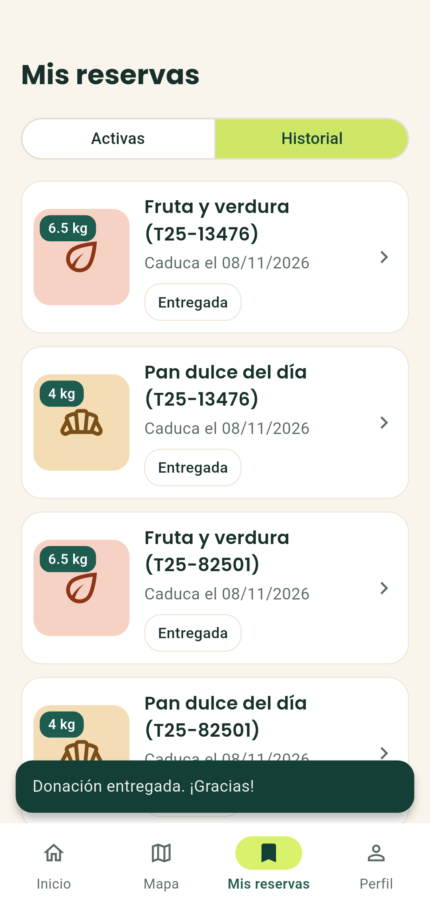 |

## Observaciones para T26 (corrección de errores)

Ninguna historia falló. Se anotan estos puntos:

1. **Ícono de la app.** La notificación y el lanzador muestran el ícono de Flutter por defecto. Conviene poner el ícono de ReParte antes de generar el APK de release (T27).
2. **Reglas de Firestore pendientes de publicar.** Las reglas nuevas de T20 (una sola reserva) y T23 (cierre como entregada) ya están en `firestore.rules`, pero falta `firebase deploy --only firestore:rules`. Mientras tanto, la doble reserva ya la impide la transacción de la app, como se ve en H4.
3. **Avisos con la app cerrada.** El aviso llega con la app abierta o en segundo plano. Con la app totalmente cerrada haría falta Cloud Functions + FCM (plan Blaze), como se explica en T21.
4. **Ubicación por GPS.** Esta prueba no usa "Mi ubicación", porque el permiso de ubicación es un diálogo del sistema que la prueba no puede tocar. Sin coordenadas, el detalle no muestra "Ver ruta en el mapa". La ruta y el GPS se probaron a mano en el mismo teléfono en T31.
